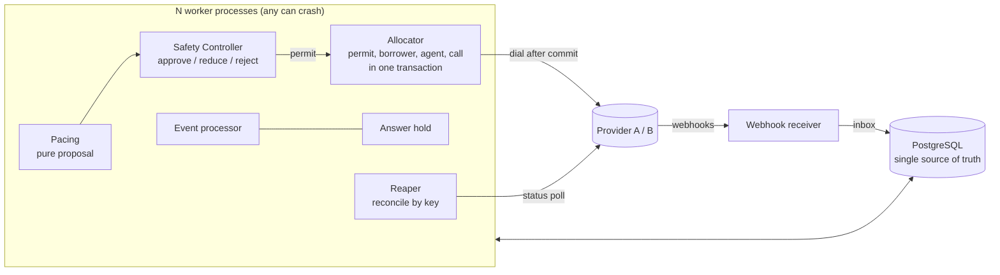

# SmartDialer

**An outbound dialer control plane for collections, coordinated only through PostgreSQL.**
Progressive and predictive dialing across many worker processes, where no call is placed unless a
Safety Controller has approved it. Built for the CredResolve take-home (`ASSIGNMENT.md`).


Start with **[docs/FINAL_ANSWER.md](docs/FINAL_ANSWER.md)** (the short answer to the brief's final question),
then [docs/ARCHITECTURE.md](docs/ARCHITECTURE.md).

## Contents

- [What it guarantees](#what-it-guarantees)
- [Architecture](#architecture)
- [How one call flows](#how-one-call-flows)
- [The Safety Controller](#the-safety-controller)
- [Quick start](#quick-start)
- [Failure demos](#failure-demos)
- [Measured results](#measured-results)
- [Configuration](#configuration)
- [Known limits and what is not built](#known-limits-and-what-is-not-built)
- [Where each part of the brief lives](#where-each-part-of-the-brief-lives)
- [Documentation](#documentation)
- [Repository map](#repository-map)

## What it guarantees

- **No borrower is called twice at once, no agent is bound to two calls.** Every race is closed by the
  database (row locks, `SKIP LOCKED`, fencing tokens, unique keys), and each place carries a
  `# CONCURRENCY:` comment. `tests/test_races.py` runs 50 processes against the same rows.
- **Pacing cannot dial.** It only proposes a number. The Safety Controller turns it into a permit (approve,
  reduce, reject or fall back to progressive), and every decision is logged to `safety_decisions` with its
  inputs and reason codes.
- **Crashes lose nothing and guess nothing.** Provider events land in an inbox (deduplicated, applied in
  order per call). A worker can die at any point; another one reconciles the call with the provider by
  idempotency key.
- **An abandoned call is never recorded as connected.** An answer applied after the hold time, or after the
  call already ended, is ABANDONED and counts toward the abandon budget.
- **Decision logic is pure** and shared by the live workers and a discrete-event simulator.

## Architecture



There is no cache, queue or broker. Every worker runs the same loop; one of them holds a lease as the
campaign's pacing leader. Details, lock order and sequence diagrams: [docs/ARCHITECTURE.md](docs/ARCHITECTURE.md).

## How one call flows

1. **Pace.** Every 250 ms the pacing leader (lease + fencing token) reads one consistent snapshot of the
   campaign and proposes a number: progressive asks for one call per available agent; predictive estimates
   how many answers the free and soon-free agents can absorb.
2. **Decide.** The Safety Controller re-reads the snapshot itself (it never trusts the pacer's numbers),
   applies every rule below, revokes the previous permit and issues a new one for the approved count.
3. **Allocate.** Any worker claims units from the permit, then in one transaction leases a borrower, reserves
   an agent (progressive) and writes the call. Nothing is dialed until that transaction commits.
4. **Dial.** The provider is called with the call id as idempotency key, so a retry or a crash cannot place
   a second call.
5. **Events.** Provider webhooks go into the inbox. Any worker applies them in order per call through the
   state machines; duplicates and stale events are recorded but change nothing.
6. **Answer.** A progressive call is bridged to its reserved agent. A predictive call waits up to
   `max_answer_hold_ms` (2 s) for a free agent, then is abandoned and counted.
7. **Recover.** The reaper asks the provider about any call stuck too long and feeds the answer back through
   the same inbox. One reaper per call, by lease.

## The Safety Controller

Each rule records a reason code; the strictest effect wins (REJECT, then FALLBACK_TO_PROGRESSIVE, then REDUCE).
Code: `smartdialer/domain/safety_rules.py`.

| Reason code | Effect | When |
|---|---|---|
| `NOT_PACING_LEADER` | REJECT | The proposer's lease or fencing token is not current |
| `STALE_SNAPSHOT` | REJECT | The proposal was computed on data older than 1 s |
| `OUTSIDE_CALLING_WINDOW` | REJECT | Campaign local time outside 08:00 to 19:00 |
| `PROVIDER_HEALTH` | REJECT / REDUCE | Breaker OPEN: reject. DEGRADED: halve. HALF_OPEN: at most 3 probe calls |
| `EVENT_LAG` | REJECT | Provider events reach us later than the 2 s answer hold (p90 over 10 s, or the oldest unprocessed event). Any new call would be abandoned before we see its answer |
| `COLD_START` | Progressive | Fewer than 50 resolved dials to estimate an answer rate |
| `ABANDON_BUDGET` | Progressive | Abandon rate at or above 3% of the last 100 answered calls (hysteresis: resumes below 1.5% for 60 s) |
| `AGENT_DROP` | Progressive | Staffed agents fell more than 20% against the recent maximum (30 s cooldown) |
| `ANSWER_RATE_DRIFT` | Progressive | The short answer-rate window disagrees with the long one, both by size and by a z-test |
| `HARD_RATIO_CAP` | REDUCE | Unanswered calls in flight may not exceed 2.5 x agents available now, and 500 in absolute terms |
| `PROGRESSIVE_BUDGET` | REDUCE | Progressive: never more calls than agents available now |
| `RECOVERY_RAMP` | REDUCE | After startup or any pause in dialing, approvals ramp from 20% to 100% over 20 s |
| `MAX_PER_TICK` | REDUCE | No decision approves more than 50 calls, in any mode |

## Quick start

Requires Docker Desktop, running (`docker info` must succeed). All Python runs inside the `app`
container; nothing is installed on the host.

```bash
make up
```

```bash
make migrate
```

```bash
make test
```

Without `make` (Windows): `python tasks.py up`, `python tasks.py test`, `python tasks.py demo-worker-crash`.
`tasks.py` only shells out to `docker compose`.

| Command | What it does |
|---|---|
| `make test` | Full suite (608 tests): state machines, 50-process races, fencing, permits, crash windows, events, pacing, safety rules, simulator |
| `make sim` | Simulator, scenarios A to F, progressive vs predictive, Provider A vs B. Writes `docs/SIMULATION_RESULTS.md` and `docs/img/` |
| `make loadtest` | 1,000 agents, 50,000 borrowers, 8 workers, 60 s ([docs/SCALING.md](docs/SCALING.md)) |
| `make psql` | psql into the dialer database |
| `make shell` | bash in the app container |
| `make down` | Stop and delete the database volume |

## Failure demos

Each demo runs real processes (workers, mock provider, webhook receiver) against Postgres, then runs the
invariant checks over the history tables and prints `RESULT: PASS` or `FAIL`.

| Command | Scenario |
|---|---|
| `make demo-duplicate-events` | Same webhook delivered many times: applied once |
| `make demo-out-of-order` | Events arrive COMPLETED, ANSWERED, RINGING: ends COMPLETED, counted as an abandon, late events ignored |
| `make demo-worker-crash` | Worker SIGKILLs itself after commit before dial, and after dial before INITIATED. Another worker reconciles both by idempotency key |
| `make demo-crash-after-answered` | Worker SIGKILLs itself while applying ANSWERED, before and after COMMIT. Before: an abandon, counted. After: connected |
| `make demo-agent-drop` | 40 of 100 agents go offline within 3 s during predictive dialing: forced progressive within one tick of the threshold |
| `make demo-provider-outage` | Provider B hangs for 25 s: breaker opens, dialing stops, HALF_OPEN probes, gradual ramp back up. Then its webhooks stall 6 s: EVENT_LAG rejects all dials until the inbox catches up |
| `make demo-answer-rate-shock` | Answer rate jumps 20% to 70% (and drops 70% to 10%), in the simulator |

## Measured results

**Load test** (1,000 agents, 8 workers, one 8-CPU machine shared with the mock provider):

| Reservations/s | p50 / p99 reservation | Answered | Abandoned | Invariant violations |
|---|---|---|---|---|
| 102.8 | 6.4 / 36 ms | 1,876 | 0 | 0 |

Every decision hit the 50-per-tick cap, so throughput is held there on purpose. Runs above 8 workers on one
machine starve the mock provider of CPU and measure the test harness, not the dialer. Full analysis, the
bottleneck history and 100 to 100,000 agents: [docs/SCALING.md](docs/SCALING.md).

**Simulator** (one hour per scenario, Provider A): predictive raises utilization from 45% to 64% at a 20%
answer rate, +12% at 50% and +2% at 70%, with the worst abandon rate at 0.98%. On Provider B, lost ANSWERED
events alone push even progressive to 1.7 to 2.7% abandons. Tables and charts:
[docs/SIMULATION_RESULTS.md](docs/SIMULATION_RESULTS.md).

## Configuration

Every setting has a default in `smartdialer/config.py` and can be overridden per campaign in
`campaigns.settings` (jsonb). The ones that shape safety:

| Setting | Default | Meaning |
|---|---|---|
| `pacing_tick_ms` | 250 | How often the pacing leader decides |
| `permit_ttl_ms` | 2000 | How long an approval stays valid |
| `max_answer_hold_ms` | 2000 | How long an answered predictive call may wait for an agent |
| `abandon_threshold` / `abandon_resume` | 0.03 / 0.015 | Abandon budget trip and resume levels |
| `max_overdial_ratio` / `absolute_inflight_cap` | 2.5 / 500 | Hard caps on unanswered calls in flight |
| `max_approved_per_tick` | 50 | Largest single approval |
| `recovery_ramp_s` / `recovery_start_factor` | 20 / 0.2 | Ramp after startup or any pause |
| `event_lag_window_s` | 10 | Window for the EVENT_LAG percentile |
| `window_start` / `window_end` | 08:00 / 19:00 | Calling window in the campaign's timezone |

Tests, demos and the load test pin the wall clock the calling window reads (`SMARTDIALER_NOW`,
`smartdialer/clock.py`) instead of opening the window.

## Known limits and what is not built

Each is explained in [docs/INTERVIEW_PREP.md](docs/INTERVIEW_PREP.md) and [docs/SCALING.md](docs/SCALING.md).

- **One loop per worker.** Pacing ticks, dials, events and status polls share it, so ticks arrive every
  ~450 ms instead of 250 ms, and a hung provider delays answer processing for every call. Fix: a separate
  loop for latency-critical work. NOT BUILT.
- **EVENT_LAG is reactive.** It needs events to arrive late before it knows they are late; the ramp and the
  per-tick cap make that rare rather than impossible.
- **The breaker goes blind at low traffic.** It judges live call outcomes only. Fix: a minimum volume
  before judging, or an active health probe. NOT BUILT.
- **Answer-rate drift is detected after about 50 s**, because the window only counts calls whose outcome is
  known. The hard ratio cap carries the risk until then.
- **No real telecom provider.** Two mock providers with fault injection instead (ADR-8).

## Where each part of the brief lives

| The brief asks for | Here |
|---|---|
| Progressive dialer | `smartdialer/pacing/progressive.py`, `smartdialer/allocator/` |
| Predictive pacing engine | `smartdialer/pacing/predictive.py` |
| Safety Controller | `smartdialer/safety/`, `smartdialer/domain/safety_rules.py` |
| Agent and call state machines | [docs/STATE_MACHINES.md](docs/STATE_MACHINES.md), `smartdialer/domain/` |
| Two workers, same agent | `smartdialer/allocator/`, `tests/test_races.py`, [INTERVIEW_PREP Q1](docs/INTERVIEW_PREP.md) |
| Duplicate and out-of-order events, crash after ANSWERED | `smartdialer/events/`, demos above |
| Two mock providers that behave differently | `mock_provider/app.py` |
| Provider failing | Breaker, EVENT_LAG, reaper; `make demo-provider-outage` |
| 100 agents, 40 leave | `make demo-agent-drop` |
| Simulator with scenarios A to D (plus E, F) | `sim/`, [docs/SIMULATION_RESULTS.md](docs/SIMULATION_RESULTS.md) |
| Scale: what breaks first | [docs/SCALING.md](docs/SCALING.md) |
| Architecture decisions | [docs/ADR.md](docs/ADR.md) |
| Final question | [docs/FINAL_ANSWER.md](docs/FINAL_ANSWER.md) |

## Documentation

| Document | Contents |
|---|---|
| [FINAL_ANSWER](docs/FINAL_ANSWER.md) | The short answer to the brief's final question |
| [ARCHITECTURE](docs/ARCHITECTURE.md) | Components, lock order, failure handling table, sequence diagrams |
| [STATE_MACHINES](docs/STATE_MACHINES.md) | Call, agent and borrower states and every allowed transition |
| [ADR](docs/ADR.md) | Decisions, the alternatives rejected, and what each one makes harder |
| [SCALING](docs/SCALING.md) | Load test, bottlenecks and their history, 100 to 100,000 agents |
| [SIMULATION_RESULTS](docs/SIMULATION_RESULTS.md) | Progressive vs predictive across six scenarios, with charts |
| [INTERVIEW_PREP](docs/INTERVIEW_PREP.md) | Hard questions, known weaknesses, and what is NOT BUILT |
| [PLAN](PLAN.md) | Build plan and the decision log (D1 onward) |

## Repository map

```
smartdialer/
  domain/        pure: state machines, safety rules, stats, breaker, backoff, calling window
  pacing/        pure: progressive and predictive proposals
  safety/        Safety Controller, snapshot, pacing leader lease, breaker store
  allocator/     permit -> borrower -> agent -> call in one transaction, dial after commit
  events/        webhook receiver (inbox), event processor, answer hold
  recovery/      reaper (reconciliation, leased per call), heartbeat
  worker/        the worker loop: sequences the above, no logic of its own
  transitions.py the only path that changes call or agent state
  invariants.py  checks run after every demo, test and load run
  clock.py       wall clock for the calling window, pinned by tests and demos
mock_provider/   Providers A and B with fault injection (/control)
sim/             discrete-event simulator reusing the pure modules
loadtest/        multi-process load test
demos/           one script per failure scenario
migrations/      plain SQL, applied in order
tests/
docs/
```

## Ground rules this code keeps

- PostgreSQL is the only source of truth. No cache, no queue.
- Every race is closed by the database, with a `# CONCURRENCY:` comment at each place.
- Decision logic is pure functions, shared by the workers and the simulator.
- No test or demo disables or loosens a safety rule to pass. Tests pin the clock instead of opening
  the calling window, and the mock provider never makes a borrower hang up faster than a dialer
  could bridge them unless a scenario asks for it.
